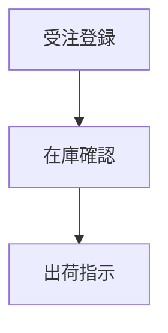

# Docs as Code 学習メモ

## 概要

Docs as Code とは、

> ドキュメントをソフトウェアソースコードと同じように管理する考え方

である。

従来のように Word、Excel、PowerPoint をファイルサーバーで管理するのではなく、Markdown と Git を利用してドキュメントを構成管理する。

---

# なぜ Docs as Code が注目されるのか

従来のドキュメント管理では以下のような問題が発生しやすい。

```text
基本設計書_v1.docx
基本設計書_v1_修正版.docx
基本設計書_v1_修正版_final.docx
基本設計書_v1_修正版_final2.docx
```

その結果、

- 最新版がわからない
- 変更履歴が追えない
- 誰が何を修正したかわからない
- ソースコードとの対応関係が不明

という課題が発生する。

Docs as Code では、

```text
Markdown
↓
Git Repository
↓
Pull Request
↓
レビュー
↓
Release
```

という開発と同じプロセスで管理する。

---

# 主なメリット

## 構成管理ができる

以下を Git で管理できる。

- 要件定義書
- 基本設計書
- 詳細設計書
- テスト仕様書
- 運用手順書

---

## 変更履歴が残る

誰が

- いつ
- 何を
- なぜ

変更したのかを追跡できる。

---

## レビュー履歴が残る

Issue や Pull Request によって、

- 顧客レビュー
- 設計レビュー
- 指摘事項

を管理できる。

---

## AIとの相性が良い

Markdown はテキストベースのため、

以下のような活用が可能。

```text
設計書からテストケースを生成

業務ルールの矛盾を検出

機能間の整合性確認

提案書ドラフト作成
```

---

# 推奨構成

## Repository構成例

```text
project-repository

├─ src/
├─ test/
├─ docs/
│
├─ requirements/
│   ├─ business-requirements
│   └─ system-requirements
│
├─ basic-design/
│   ├─ SCR-001/
│   ├─ SCR-002/
│   └─ SCR-003/
│
└─ README.md
```

---

# 設計単位の管理例

機能単位でディレクトリを作成する。

```text
SCR-001/

├─ README.md
├─ flow.png
├─ screen.png
└─ sequence.png
```

README.md を正本とする。

---

# レビュー運用

## 推奨

```text
設計書 → Markdown

レビュー → GitHub Issues
```

例

```text
Issue #25

対象:
SCR-001

内容:
代引商品の登録パターンが不足している
```

---

## メリット

- 設計書とレビュー履歴が紐付く
- 修正理由が追跡可能
- 対応状況が見える
- 将来の保守時に経緯を確認できる

---

# Markdownと画像

## 一般的な方法

```text
SCR-001/

├─ README.md
├─ flow.png
└─ screen.png
```

Markdown

```markdown
# 業務フロー

flow.png

# 画面イメージ

screen.png
```

---

## Base64埋め込み

技術的には可能。

```markdown
data:image/png;base64,...
```

ただし、

- Git差分が見づらい
- ファイルサイズが肥大化する
- レビューしづらい

ため通常は推奨されない。

---

## Mermaid利用

業務フローであれば Mermaid が有効。

```markdown

```

メリット

- テキスト管理可能
- Gitで差分管理可能
- AIが理解しやすい
- GitHub標準対応

---

# MkDocsとは

MkDocs は

> Markdown からドキュメントサイトを生成するツール

である。

---

## 関係図

```text
Markdown
↓
GitHub Repository
↓
MkDocs
↓
HTMLサイト
↓
利用者が参照
```

---

## GitHubとの違い

|役割|ツール|
|------|------|
|ソース管理|GitHub|
|ドキュメント生成|MkDocs|
|サイト公開|GitHub Pages|

MkDocs は GitHub の機能ではなく、別のツールである。

---

# 推奨アーキテクチャ

```text
Markdown
↓
GitHub Repository
↓
Issue管理
↓
構成管理
↓
MkDocs
↓
顧客向けサイト
```

考え方としては、

- GitHub = 正本管理
- MkDocs = 閲覧性向上

である。

---

# 学習ロードマップ

## Step1

Markdown

学習内容

- 見出し
- テーブル
- リスト
- リンク
- 画像

---

## Step2

Git

学習内容

- Commit
- Branch
- Merge
- Tag

---

## Step3

GitHub

学習内容

- Repository
- Pull Request
- Issues
- Discussions

---

## Step4

Docs as Code

学習内容

- ドキュメント構成
- レビュー運用
- 構成管理

---

## Step5

MkDocs

学習内容

- サイト生成
- ナビゲーション設定
- 検索機能
- GitHub Pages連携

---

# 参考サイト

## Write the Docs

Docs as Code の代表的コミュニティ

https://www.writethedocs.org/

---

## Docs as Code Guide

https://www.writethedocs.org/guide/docs-as-code/

---

## MkDocs

https://www.mkdocs.org/

---

## Material for MkDocs

https://squidfunk.github.io/mkdocs-material/

---

## GitHub Docs

https://docs.github.com/

---

# 今回の案件への適用イメージ

## 目標

- Markdownを正本化
- GitHubで構成管理
- 顧客レビュー実施
- AI活用を促進
- 将来の保守・改修に対応

## 推奨構成

```text
GitHub Repository

basic-design/
├─ SCR-001/
├─ SCR-002/
├─ SCR-003/

Issues
├─ レビュー指摘
├─ 質問
└─ 変更要求
```

将来的に

```text
Markdown
↓
MkDocs
↓
設計書サイト化
```

を追加することで、顧客向け閲覧性を向上できる。
